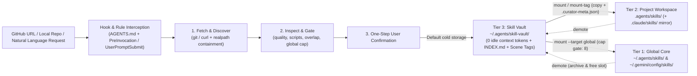

<div align="center">


# Skill Curator

**Stop dumping AI skills into your global prompt.**<br/>
Curate, audit, store, and copy-mount agent skills across a strictly capped **Global Core**, copy-isolated **Project Workspaces**, and a zero-token-cost **Skill Vault**.

**English** | [简体中文](./README.zh-CN.md)


-3776AB.svg)


</div>

---

## Why Skill Curator?

Desktop AI coding agents make it dangerously easy to paste a GitHub link into chat and say *"install this skill"*. Over a few weeks, that convenience creates four real problems:

1. **Global Context Bloat**: Every skill left inside `~/.agents/skills` or `~/.claude/skills` injects its metadata into *every* conversation—eating context budget and degrading recall even when you only needed that skill for one weekend repo.
2. **Trigger Collisions & Duplication**: Collecting dozens of skills with overlapping trigger descriptions (*"review PRs"*, *"format markdown"*, *"write articles"*) causes the wrong skill to fire or forces your agent to hesitate between redundant instructions.
3. **Unvetted Installs & Broken Symlinks**: Blindly cloning repositories can drop 1,000-line `SKILL.md` prompts or uninspected executable scripts into global scope, while symlink-based setups break across sandboxed subagents, containers, and team Git repos.
4. **Lost Libraries Across Machines**: If you delete skills out of fear of bloat, you end up hunting down the same GitHub URLs again next month on a new laptop.

### Purpose & Core Philosophy

**Skill Curator** turns ad-hoc skill hoarding into a calm, deterministic workflow:

- **Collect unlimited skills at 0 idle token cost** inside an out-of-band, Git-friendly **Skill Vault** indexed by a human-readable `INDEX.md`.
- **Keep your everyday Global Core sharp** with a configurable soft cap (default `8` deduplicated skills).
- **Intercept links & install intents automatically** via always-on rules (`AGENTS.md` / `CLAUDE.md`) and pre-invocation hooks (`PreInvocation` / `UserPromptSubmit`), so you never have to memorize CLI flags.
- **Inspect before activating**—catching name errors, vague/bloated descriptions, `>500`-line instruction files, executable scripts, and cross-tier keyword overlaps before anything touches an active directory.
- **Mount cleanly by copy (never symlinks)** per project or by **Scene Tag** batch (`writing`, `wechat-writing`, `backend`), automatically mirroring to `.claude/skills/` when Claude Code is used.

---

## Three-Tier Architecture



| Tier | Physical Path | Token Cost | Purpose & Rules |
| --- | --- | --- | --- |
| **Tier 1 · Global Core** | `~/.agents/skills/` (and `~/.gemini/config/skills/` if configured) | Loaded every session | Everyday cross-project skills only. Enforces a deduplicated soft cap (default **8**, excluding `skill-curator` and plugin bundles). |
| **Tier 2 · Project Workspace** | `<project>/.agents/skills/` (+ `<project>/.claude/skills/` mirror) | Loaded in this repo | Self-contained **copy-mounts** with `.curator-meta.json` provenance. Safe for Git, Docker, and isolated subagents. |
| **Tier 3 · Skill Vault** | Standalone folder (e.g. `~/.agents/skill-vault/`) | **0 tokens** when idle | Cold library outside all agent discovery paths. Indexed by a plain Markdown `INDEX.md` table and grouped by **Scene Tags**. |

---

## Real-World Walkthrough

Below is an actual test session in Antigravity when pasting a multi-skill GitHub repository URL (`https://github.com/Nanako0129/sepia`) with **zero spaces** before the Chinese request:

> **User**: `https://github.com/Nanako0129/sepia帮我装一下这个 Skills`
>
> *(PreInvocation Hook detects the clean URL `https://github.com/Nanako0129/sepia`, loads `skill-curator`, clones & inventories the repo without touching `~/.agents/skills/`)*
>
> **Agent**: Found 6 skills in `https://github.com/Nanako0129/sepia`:
> | name | rel_path | description |
> | --- | --- | --- |
> | `sepia` | `skills/sepia` | Core prose/de-AI skill (`write` / `review` / `refactor` / `recreate`). |
> | `sepia-hemingway` | `skills/sepia-hemingway` | Applies Hemingway-style prose rules. |
> | `sepia-recreate` | `skills/sepia-recreate` | Full rewrite mode. |
> | `sepia-refactor` | `skills/sepia-refactor` | Minimal in-place prose edits. |
> | `sepia-review` | `skills/sepia-review` | Read-only prose diagnostic. |
> | `sepia-write` | `skills/sepia-write` | Drafts new prose. |
>
> Which skill(s) would you like to inspect and install?

> **User**: `都帮我装一下吧` *(Install all of them)*
>
> **Agent**: Pulled and audited all 6 `sepia` skills:
> - **Size & Security**: `sepia` is 72 lines (724-char description); the remaining 5 are 13 lines each (68–159 chars). Zero instruction bloat (`>500` lines), zero executable scripts (`scripts_detected: []`).
> - **Collisions & Cap**: `exact_collisions: []`; Global Core occupancy is currently `1/8` (`ego-browser`). Putting all 6 directly into Global Core would jump to `7/8`, so I recommend:
>   1. **Store in `vault` only (Recommended)** — zero idle token cost, mount anytime by name or tag.
>   2. **Mount to `project`** (`.agents/skills/` + `.claude/skills/`).
>   3. **Mount to `global`** (or `sepia` global + 5 in Vault).
> - **Suggested Scene Tags**: `writing, prose, de-ai`

> **User**: `帮我先仅挂存到 Vault` *(Store in Vault only for now)*
>
> **Agent**: Stored all 6 skills into `~/.agents/skill-vault/skills/`, updated `INDEX.md`, verified via `curator.py search "sepia"` (`count: 6`), left Global Core at `1/8`, and cleaned up temporary staging files.

Resulting `~/.agents/skill-vault/INDEX.md`:

```markdown
# Skill Vault Index

| Name | Keywords | Scene Tags | Source | Path |
| --- | --- | --- | --- | --- |
| sepia | sepia, writing, prose, de-ai, humanize, story | writing, prose, de-ai | https://github.com/Nanako0129/sepia | skills/sepia |
| sepia-hemingway | sepia, hemingway, fiction, de-ai, voice | writing, prose, de-ai | https://github.com/Nanako0129/sepia | skills/sepia-hemingway |
| sepia-recreate | sepia, recreate, rewrite, prose, de-ai | writing, prose, de-ai | https://github.com/Nanako0129/sepia | skills/sepia-recreate |
| sepia-refactor | sepia, refactor, revision, prose, de-ai | writing, prose, de-ai | https://github.com/Nanako0129/sepia | skills/sepia-refactor |
| sepia-review | sepia, review, diagnose, prose, de-ai | writing, prose, de-ai | https://github.com/Nanako0129/sepia | skills/sepia-review |
| sepia-write | sepia, write, prose, de-ai | writing, prose, de-ai | https://github.com/Nanako0129/sepia | skills/sepia-write |
```

---

## Installation

### Prerequisites

- **Runtime**: Python `3.9+` (standard library only), `git`, and `curl`
- **Optional (for one-line npm install)**: Node.js / `npx`

### Option 1: Official npm `skills` CLI (Codex, Cursor, OpenCode, Claude Code, Antigravity)

`Skill Curator` follows the open **Agent Skills** (`SKILL.md`) standard and is directly discoverable by Vercel Labs' [`npx skills`](https://skills.sh/) CLI right from the repository root:

```bash
# Install globally for OpenAI Codex (copy mode, non-interactive)
npx skills add Khalilzhang0825/skill-curator -a codex -g --copy -y

# Or install across multiple agents at once (Codex, Claude Code, Cursor, OpenCode, Antigravity)
npx skills add Khalilzhang0825/skill-curator -a codex claude-code cursor opencode antigravity -g --copy -y

# Or install into the current Project Workspace only
npx skills add Khalilzhang0825/skill-curator --skill skill-curator --copy
```

> [!NOTE]
> `npx skills add` installs the **Skill + CLI scripts** (`SKILL.md` + `scripts/`), which works immediately on **Codex** (`~/.agents/skills/`) and all `AGENTS.md` agents. To enable **automatic pre-invocation URL hooks** (`PreInvocation` / `UserPromptSubmit`) and **always-on plugin rules**, use Option 2 (Antigravity Plugin) or Option 3 (Claude Code Plugin), or append [`skill-curator/rules/AGENTS.md`](./skill-curator/rules/AGENTS.md) to your global `~/.codex/AGENTS.md` / `~/.agents/AGENTS.md`.

### Option 2: Antigravity (Full Plugin with PreInvocation Hook + Rules + Logo)

Install from a GitHub Release archive (`skill-curator-v0.1.0.tar.gz` / `.zip`) or build from source:

```bash
# 1. Clone the repository and build the clean runtime archive (or download from GitHub Releases)
git clone https://github.com/Khalilzhang0825/skill-curator.git skill-curator-repo
cd skill-curator-repo
python3 ./scripts/package.py

# 2. Extract into Antigravity's global plugins folder
mkdir -p ~/.gemini/config/plugins
tar -xzf ./dist/skill-curator-v0.1.0.tar.gz -C ~/.gemini/config/plugins

# 3. Initialize your Skill Vault & config (~/.config/skill-curator/config.json)
python3 ~/.gemini/config/plugins/skill-curator/skills/skill-curator/scripts/curator.py init \
  --vault ~/.agents/skill-vault \
  --global-dir ~/.agents/skills \
  --global-dir ~/.gemini/config/skills \
  --config ~/.config/skill-curator/config.json
```

Start a new Antigravity conversation (or toggle `skill-curator` in Customizations). Antigravity automatically loads `plugin.json`, `hooks.json` (`PreInvocation`), `rules/AGENTS.md`, `assets/logo.png`, and `skills/skill-curator/SKILL.md`.

### Option 3: Claude Code (Full Plugin with `UserPromptSubmit` Hook)

Load the plugin directly via `--plugin-dir` (or copy `skill-curator/` into your Claude plugins directory):

```bash
claude --plugin-dir /path/to/skill-curator-repo/skill-curator
```

Initialize your Skill Vault once:

```bash
python3 ./skill-curator/skills/skill-curator/scripts/curator.py init \
  --vault ~/.agents/skill-vault \
  --global-dir ~/.claude/skills \
  --claude-sync auto \
  --config ~/.config/skill-curator/config.json
```

Project mounts automatically mirror from `.agents/skills/` to `.claude/skills/` whenever `.claude/` or `CLAUDE.md` exists in the project root.

### First-Time Initialization (Required Once for Any Harness)

Whether you installed via `npx skills add` or the full plugin bundle, initialize your personal Skill Vault once:

```bash
python3 ~/.agents/skills/skill-curator/scripts/curator.py init \
  --vault ~/.agents/skill-vault \
  --config ~/.config/skill-curator/config.json
```

*(If you omit `--vault` or forget to run `init`, the first `skill-curator` conversation will ask where to store your Skill Vault and run `init` for you.)*

---

## Usage

### 1. Everyday Conversational Flow

Once installed, simply talk to your agent naturally:

- **Collect from GitHub (full repo, `/tree/` subdirectory, or `/blob/.../SKILL.md`)**:
  > *"https://github.com/owner/repo install this skill"*
- **Search your Vault later in another project**:
  > *"Search my Skill Vault for database migration skills"* / *"帮我找一下之前存的写作或排版 skills"*
- **Batch-mount a workflow stack by Scene Tag**:
  > *"Mount all `writing` Scene Tag skills into this project"*
- **Run a periodic hygiene audit**:
  > *"Run a health audit on my Global Core and current project skills"*

### 2. CLI Reference (`curator.py`)

Every command supports `--config <path>` or `SKILL_CURATOR_CONFIG` (default fallback: `~/.config/skill-curator/config.json`) and outputs structured JSON.

| Command | Purpose | Example |
| --- | --- | --- |
| `init` | Initialize Skill Vault, `INDEX.md`, and `config.json` | `curator.py init --vault ~/.agents/skill-vault --global-cap 8` |
| `fetch` | Clone/download a skill URL or return multi-skill inventory (`--all` stages all in 1 clone) | `curator.py fetch "https://github.com/owner/repo" --all --timeout 30` |
| `inspect` | Audit naming, description, line count, scripts, overlaps, and cap | `curator.py inspect --source-dir /tmp/staged/my-skill --project-dir .` |
| `store` | Save vetted skill into Skill Vault and upsert `INDEX.md` | `curator.py store --source-dir /tmp/staged/my-skill --keywords "pdf,ocr" --tags "docs" --source-url "..."` |
| `mount` | Copy-mount a Vault skill into `project` or `global` (cap-gated) | `curator.py mount my-skill --target project --project-dir .` |
| `mount-tag` | Batch copy-mount all Vault skills sharing a Scene Tag into a project | `curator.py mount-tag writing --project-dir .` |
| `search` | Search Vault by English/Chinese keywords, description, or `--tag` | `curator.py search "公众号排版" --limit 10` |
| `demote` | Archive an active skill into Skill Vault and remove active mounts | `curator.py demote my-skill --from global` |
| `health` | Audit active skills for cap, duplicates, bloat, and stale `mounted_at` | `curator.py health --project-dir . --stale-days 30` |

<details>
<summary>Configuration Schema &amp; Vault <code>INDEX.md</code> Format</summary>

Default config (`~/.config/skill-curator/config.json`):

```json
{
  "vault_path": "~/.agents/skill-vault",
  "global_core_dirs": [
    "~/.agents/skills",
    "~/.gemini/config/skills"
  ],
  "global_cap": 8,
  "claude_sync": "auto",
  "stale_days": 30
}
```

- `claude_sync`: `"auto"` (mirrors to `.claude/skills/` when `.claude` or `CLAUDE.md` exists), `"always"`, or `"never"`.
- `INDEX.md` (safe to commit to Git and edit manually—manual edits merge cleanly with `.curator-meta.json`):

```markdown
# Skill Vault Index

| Name | Keywords | Scene Tags | Source | Path |
| --- | --- | --- | --- | --- |
| my-skill | pdf, ocr | docs, extraction | https://github.com/example/repo | skills/my-skill |
```

</details>

---

## Security & Safety Guarantees

- **Path Containment**: `fetch`, `store`, `mount`, `inspect`, and `demote` resolve every entry with `os.path.realpath` and abort on any broken symlink or path escaping the skill root.
- **No Auth / Hang Traps**: `git` invocations set `GIT_TERMINAL_PROMPT=0` and `GIT_ASKPASS=/bin/echo` with explicit subprocess `--timeout` limits so background runs never hang on password prompts or dead sockets.
- **Fail-Open Hook**: Invalid/empty hook stdin, continuation steps (`invocationNum >= 1`), or unrelated coding prompts exit `0` with `{}`.
- **Protected Targets**: `demote` refuses to remove `skill-curator` itself or external plugin bundles (`plugin.json`, `.claude-plugin/plugin.json`, `gemini-extension.json`), and `scan_global_core` excludes them from the 8-skill Global Core cap.

---

## Repository Layout, Packaging & Tests

```text
.
├── README.md                          # English documentation
├── README.zh-CN.md                    # 简体中文文档
├── LICENSE                            # MIT License
├── GLOSSARY.md                        # Canonical domain terms
├── docs/adr/                          # Architecture Decision Records (ADR-0001, ADR-0002)
├── scripts/package.py                 # Builds clean release .tar.gz / .zip / SHA256SUMS in dist/
└── skill-curator/                     # Distributable cross-agent plugin bundle
    ├── plugin.json                    # Antigravity plugin manifest (references assets/logo.png)
    ├── hooks.json                     # Antigravity PreInvocation hook config
    ├── assets/logo.png                # 512x512 Skill Curator icon
    ├── .claude-plugin/plugin.json     # Claude Code plugin manifest
    ├── hooks/hooks.json               # Claude Code UserPromptSubmit hook config
    ├── CLAUDE.md                      # Claude Code rule adapter
    ├── rules/AGENTS.md                # Portable always-on curation rules
    ├── README.md                      # Standalone bundle quick reference
    ├── skills/skill-curator/
    │   ├── SKILL.md                   # Curator workflow instructions
    │   ├── references/                # config-schema.md & vault-index-template.md
    │   └── scripts/                   # curator.py, fetcher.py, auditor.py, lifecycle.py, common.py, hook_intercept.py
    └── tests/                         # 37 subprocess black-box tests (unittest, stdlib only)
```

### Run the Test Suite

```bash
python3 -m unittest discover -s "./skill-curator/tests" -v
```

### Build Distributable Archives

```bash
python3 ./scripts/package.py
```

Generates clean runtime archives (excluding `__pycache__`, tests, and local scratch state) inside `./dist/`:
- `skill-curator-v0.1.0.tar.gz`
- `skill-curator-v0.1.0.zip`
- `SHA256SUMS.txt`

---

## License

[MIT](./LICENSE)
