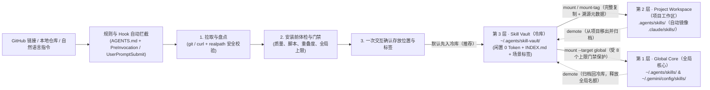

<div align="center">


# Skill Curator（技能策展人）

**别再把所有 AI Skills 一股脑塞进全局提示词了。**<br/>
将外部技能统一纳入**「全局核心（Global Core）+ 项目工作区（Project Workspace）+ 冷存储技能库（Skill Vault）」**三层体系：先拉取审计、再按需复制挂载，零闲置上下文 Token 消耗。

[English](./README.md) | **简体中文**


-3776AB.svg)


</div>

---

## 为什么要做 Skill Curator？

用 Codex、Antigravity、Claude Code 或 Cursor 时，我们经常在 GitHub 上刷到一个好用的 Skill，然后直接把链接贴进聊天框让 Agent 帮着“装一下”。短期很爽，用过几周后很快会踩进四个坑：

1. **全局上下文越来越重**：所有塞进 `~/.agents/skills` 或 `~/.claude/skills` 的 Skill，哪怕你只在某一个临时项目用过一次，之后**每一轮对话**都会加载它的描述信息，白白占用上下文预算、拖慢响应。
2. **触发冲突与重复建设**：攒了几十个语义相近的 Skill（比如好几个“排版工具”“代码审查”“写作助手”），Agent 很容易误触发或在不同规则间反复摇摆。
3. **盲目安装的风险与软链失效**：直接克隆陌生仓库，可能把上千行的超长提示词或未经审查的可执行脚本放进全局目录；而靠软链接（symlink）挂载到项目里，一旦进到隔离的子 Agent、容器或同事拉取你的 Git 仓库，路径就会直接失效。
4. **换电脑或切项目找不回**：为了防膨胀不敢乱装，或者定期一通乱删，结果下个月换新项目 / 换新机器时，又要重新满世界翻以前的 GitHub 链接。

### 我们的目的

**Skill Curator** 的目标，就是用一套**零重型依赖、完全基于本地文件系统与 Git** 的工作流，解决“想多囤技能”和“怕污染全局上下文”之间的矛盾：

- **无限囤积，闲置零开销**：把收藏到的 Skills 存进独立的 **Skill Vault（技能冷库）**，放在所有 Agent 自动扫描路径之外，通过极简可读的 `INDEX.md` 索引表管理，平时占 **0 Token**。
- **严控全局核心数量**：为 **Global Core（全局核心）** 设置去重软上限（默认 **8 个**），只留跨项目每天必用的少数精锐。
- **粘贴链接自动拦截**：通过常驻规则（`AGENTS.md` / `CLAUDE.md`）+ 生命周期 Hook（Antigravity `PreInvocation` / Claude Code `UserPromptSubmit`），你只需正常发链接或用自然语言说“装一下”，不用记任何斜杠命令。
- **先审计、一步确认再落盘**：入库前先体检命名规范、描述质量、行数膨胀、可执行脚本、跨层重名与关键词重叠；绝不擅自改写原版 `SKILL.md`，也不未经同意就删除技能。
- **按项目或“场景标签”复制挂载**：进到新项目时，按关键词检索冷库或直接按 **Scene Tag（场景标签，如 `writing`、`wechat-writing`）** 一键整组**复制挂载**进项目 `.agents/skills/`（存在 Claude Code 配置时自动镜像一份到 `.claude/skills/`）。

---

## 核心架构：三层存储模型



| 层级 | 物理位置 | 上下文开销 | 定位与约束 |
| --- | --- | --- | --- |
| **Tier 1 · Global Core（全局核心）** | `~/.agents/skills/`（及配置中的 `~/.gemini/config/skills/`） | 每次会话都加载 | 只放高频跨项目核心技能。按技能目录名跨目录去重计数，默认软上限 **8 个**（自动排除 `skill-curator` 自身与外部插件包）。 |
| **Tier 2 · Project Workspace（项目工作区）** | `<项目>/.agents/skills/`（可选同步 `<项目>/.claude/skills/`） | 仅在当前项目加载 | 通过**完整目录复制**（永不用软链接）挂载，附带 `.curator-meta.json` 记录来源与挂载时间；可直接随项目 Git 提交或交给容器/子 Agent 使用。 |
| **Tier 3 · Skill Vault（技能冷库）** | 独立目录（默认推荐 `~/.agents/skill-vault/`） | **闲置 0 Token** | 完全独立于任何 Agent 的自动扫描路径之外，整个文件夹就是标准 Git 仓库。通过一张纯 Markdown 表格 [`INDEX.md`](./skill-curator/skills/skill-curator/references/vault-index-template.md) 建立关键词与**场景标签**索引。 |

---

## 真实对话实测演示

下面是我们在 Antigravity 真实环境中，粘贴多 skill 仓库链接 `https://github.com/Nanako0129/sepia`（甚至故意把网址和中文粘在一起、中间没加空格）的完整实测记录：

> **用户**：`https://github.com/Nanako0129/sepia帮我装一下这个 Skills`
>
> *（`PreInvocation` Hook 自动识别出干净链接 `https://github.com/Nanako0129/sepia`，触发 `skill-curator` 拉取盘点，全程未动全局目录 `~/.agents/skills/`）*
>
> **Agent**：在 `https://github.com/Nanako0129/sepia` 中发现了 6 个 skill：
> | name | rel_path | description |
> | --- | --- | --- |
> | `sepia` | `skills/sepia` | 主 skill：去 AI 味、润色/重构/审查/创作小说与专业文本（含 `write`/`review`/`refactor`/`recreate` 四种操作）。 |
> | `sepia-hemingway` | `skills/sepia-hemingway` | 应用 Sepia 内置的 Hemingway 风格配置写作或修改小说。 |
> | `sepia-recreate` | `skills/sepia-recreate` | 显式调用 Sepia `recreate` 进行全文重写。 |
> | `sepia-refactor` | `skills/sepia-refactor` | 显式调用 Sepia `refactor` 进行最小化原地修改。 |
> | `sepia-review` | `skills/sepia-review` | 显式调用 Sepia `review` 对文本进行只诊断不修改的评估。 |
> | `sepia-write` | `skills/sepia-write` | 显式调用 Sepia `write` 创作新文本。 |
>
> 请确认你要检查并安装哪几个（例如：仅主 skill `sepia`，还是全部 6 个）？

> **用户**：`都帮我装一下吧`
>
> **Agent**：6 个 `sepia` skills 已拉取并完成审计，结果如下：
> - **候选列表**：`sepia`（72 行，724 字符描述）、`sepia-hemingway`、`sepia-recreate`、`sepia-refactor`、`sepia-review`、`sepia-write`（其余 5 个均为 13 行，68–159 字符描述）
> - **结构与安全检查**：6 个均无命名/描述/超长（>500 行）告警，未检测到可执行脚本（`scripts_detected: []`）
> - **冲突检查**：无同名冲突（`exact_collisions: []`）；Global Core 占用当前 `1/8`（仅 `ego-browser`）。6 个全装进全局会占到 `7/8`，建议按以下方式确认：
>   1. **仅存 `vault`（推荐默认）**：存入 Skill Vault（零常驻上下文开销，后续可按项目或 tag 一键挂载）
>   2. **挂载到 `project`**：存入 Vault 并复制到当前项目 `.agents/skills/`（及 `.claude/skills/`）
>   3. **挂载到 `global`**：存入 Vault 并安装到全局
> - **建议 Scene Tags**：`writing, prose, de-ai`

> **用户**：`帮我先仅挂存到 Vault`
>
> **Agent**：已将全部 6 个 `sepia` skills 仅存入 `~/.agents/skill-vault/skills/`，更新 `INDEX.md` 并统一打上 `writing, prose, de-ai` 标签；执行 `curator.py search "sepia"` 验证返回 6 条可检索记录，全局核心仍保持 `1/8`，并已清理临时拉取目录。

实际生成的 `~/.agents/skill-vault/INDEX.md` 效果：

```markdown
# Skill Vault Index

| Name | Keywords | Scene Tags | Source | Path |
| --- | --- | --- | --- | --- |
| sepia | sepia, writing, prose, de-ai, humanize, story | writing, prose, de-ai | https://github.com/Nanako0129/sepia | skills/sepia |
| sepia-hemingway | sepia, hemingway, fiction, de-ai, voice | writing, prose, de-ai | https://github.com/Nanako0129/sepia | skills/sepia-hemingway |
| sepia-recreate | sepia, recreate, rewrite, prose, de-ai | writing, prose, de-ai | https://github.com/Nanako0129/sepia | skills/sepia-recreate |
| sepia-refactor | sepia, refactor, revision, prose, de-ai | writing, prose, de-ai | https://github.com/Nanako0129/sepia | skills/sepia-refactor |
| sepia-review | sepia, review, diagnose, prose, de-ai | writing, prose, de-ai | https://github.com/Nanako0129/sepia | skills/sepia-review |
| sepia-write | sepia, write, prose, de-ai | writing, prose, de-ai | https://github.com/Nanako0129/sepia | skills/sepia-write |
```

---

## 安装方法

### 环境要求

- **基础运行环境**：Python `3.9+`（仅使用标准库）、`git` 与 `curl`
- **可选（使用 npm 一键安装时需要）**：Node.js / `npx`

### 方式一：官方 npm `skills` CLI 一键安装（Codex / Cursor / OpenCode / Claude Code / Antigravity 通用）

`Skill Curator` 遵循开放的 **Agent Skills**（`SKILL.md`）标准，已通过 `npx skills` 目录发现实测，可直接从 GitHub 仓库根目录一键安装：

```bash
# 1. 为 OpenAI Codex 全局安装（推荐加 --copy 保持复制隔离）
npx skills add Khalilzhang0825/skill-curator -a codex -g --copy -y

# 2. 或一次性安装到本机多种智能体（Codex / Claude Code / Cursor / OpenCode / Antigravity）
npx skills add Khalilzhang0825/skill-curator -a codex claude-code cursor opencode antigravity -g --copy -y

# 3. 仅挂载到当前项目测试
npx skills add Khalilzhang0825/skill-curator --skill skill-curator --copy
```

> [!NOTE]
> **关于 `npx skills add` 与完整插件的区别**：`npx skills add` 会自动把 `skill-curator` 的 **Skill 与脚本**安装到各智能体的标准目录（如 Codex 的 `~/.agents/skills/`），开箱即用。如果你还想在 **Antigravity / Claude Code** 中获得**“贴链接自动触发 PreInvocation / UserPromptSubmit Hook”**与**常驻规则**，请使用下面方式二/方式三安装完整插件包；在 Codex 中也可以把 [`skill-curator/rules/AGENTS.md`](./skill-curator/rules/AGENTS.md) 的规则追加到全局 `~/.codex/AGENTS.md` 或 `~/.agents/AGENTS.md`。

### 方式二：Antigravity 完整插件安装（含 `PreInvocation` Hook + 规则 + 图标）

可以直接下载 GitHub Releases 里的打包文件（`skill-curator-v0.1.0.tar.gz` / `.zip`），或者从源码仓库构建后解压到 `~/.gemini/config/plugins/skill-curator`：

```bash
# 1. 克隆仓库并构建纯净安装包（或直接从 GitHub Releases 下载）
git clone https://github.com/Khalilzhang0825/skill-curator.git skill-curator-repo
cd skill-curator-repo
python3 ./scripts/package.py

# 2. 解压到 Antigravity 全局插件目录
mkdir -p ~/.gemini/config/plugins
tar -xzf ./dist/skill-curator-v0.1.0.tar.gz -C ~/.gemini/config/plugins

# 3. 初始化个人冷库（Skill Vault）与配置文件
python3 ~/.gemini/config/plugins/skill-curator/skills/skill-curator/scripts/curator.py init \
  --vault ~/.agents/skill-vault \
  --global-dir ~/.agents/skills \
  --global-dir ~/.gemini/config/skills \
  --config ~/.config/skill-curator/config.json
```

安装后新开一个 Antigravity 对话即可生效（也可在 Customizations 页面查看图标并开关 `skill-curator` 插件）。

### 方式三：Claude Code 完整插件安装（含 `UserPromptSubmit` Hook）

使用 `--plugin-dir` 直接加载 `skill-curator/`（或将其复制到你的 Claude 插件目录）：

```bash
claude --plugin-dir /path/to/skill-curator-repo/skill-curator
```

初始化个人冷库（只需执行一次）：

```bash
python3 ./skill-curator/skills/skill-curator/scripts/curator.py init \
  --vault ~/.agents/skill-vault \
  --global-dir ~/.claude/skills \
  --claude-sync auto \
  --config ~/.config/skill-curator/config.json
```

当项目根目录存在 `.claude/` 或 `CLAUDE.md` 时，`mount` / `mount-tag` 会自动把 `.agents/skills/` 同步镜像到 `.claude/skills/`。

### 首次初始化冷库（所有方式通用，只需执行一次）

通过 `npx skills add` 安装后，执行一次 `init` 创建你的冷库与配置文件：

```bash
python3 ~/.agents/skills/skill-curator/scripts/curator.py init \
  --vault ~/.agents/skill-vault \
  --config ~/.config/skill-curator/config.json
```

*(如果忘记提前初始化，首次触发 `skill-curator` 时它也会在对话里引导你确认冷库路径并自动完成初始化。)*

---

## 使用方法

### 1. 日常对话用法（无需记忆命令）

- **粘贴 GitHub 链接收集技能（支持仓库根、`/tree/` 子目录、`/blob/.../SKILL.md`）**：
  > “`https://github.com/owner/repo` 帮我装一下这个 Skills”
- **在新项目里检索曾经存过的技能**：
  > “帮我找一下冷库里之前存的写作或公众号排版 skill”
- **按“场景标签”整组挂载到当前项目**：
  > “把 `writing` 场景标签对应的 skills 挂载到当前项目”
- **给已有技能做健康体检与清理**：
  > “帮我体检一下全局和当前项目的 skills，看看有没有重叠或长期未用的”
  > “把 `xxx` 从全局降级放回冷库吧”

### 2. CLI 命令行完整参考（`curator.py`）

所有子命令均支持 `--config <path>` 或环境变量 `SKILL_CURATOR_CONFIG`（未传时自动读取 `~/.config/skill-curator/config.json`），输出均为结构化 JSON。

| 子命令 | 用途 | 常用示例 |
| --- | --- | --- |
| `init` | 初始化 Skill Vault、`INDEX.md` 和 `config.json`（幂等） | `curator.py init --vault ~/.agents/skill-vault --global-cap 8` |
| `fetch` | 拉取 GitHub URL / 本地仓库（`--all` 一次克隆批量暂存） | `curator.py fetch "https://github.com/owner/repo" --all --timeout 30` |
| `inspect` | 安装前质量、脚本、跨层碰撞与全局上限预检查 | `curator.py inspect --source-dir /tmp/staged/my-skill --project-dir .` |
| `store` | 校验并存入 Skill Vault，同步更新 `INDEX.md` | `curator.py store --source-dir /tmp/staged/my-skill --keywords "pdf,ocr" --tags "docs" --source-url "..."` |
| `mount` | 从冷库复制挂载到项目或全局（受全局上限门禁保护） | `curator.py mount my-skill --target project --project-dir .` |
| `mount-tag` | 按场景标签把一组技能批量复制挂载到当前项目 | `curator.py mount-tag writing --project-dir .` |
| `search` | 按中英文关键词、描述或 `--tag` 检索冷库 | `curator.py search "公众号排版" --limit 10` |
| `demote` | 将全局或项目技能归档回冷库，并清理原挂载副本 | `curator.py demote my-skill --from global` |
| `health` | 检查全局超额、重名/关键词重叠、体积膨胀与 `mounted_at` 过期 | `curator.py health --project-dir . --stale-days 30` |

<details>
<summary>配置文件（<code>config.json</code>）与冷库索引（<code>INDEX.md</code>）格式说明</summary>

默认配置 `~/.config/skill-curator/config.json`：

```json
{
  "vault_path": "~/.agents/skill-vault",
  "global_core_dirs": [
    "~/.agents/skills",
    "~/.gemini/config/skills"
  ],
  "global_cap": 8,
  "claude_sync": "auto",
  "stale_days": 30
}
```

- `claude_sync`：`"auto"`（项目存在 `.claude` 或 `CLAUDE.md` 时自动镜像 `.claude/skills/`）、`"always"` 或 `"never"`。
- `INDEX.md`（支持直接随冷库提交到 Git，也支持手工编辑关键词与标签，`search`/`mount`/`mount-tag`/`inspect` 会自动与 `.curator-meta.json` 合并）：

```markdown
# Skill Vault Index

| Name | Keywords | Scene Tags | Source | Path |
| --- | --- | --- | --- | --- |
| my-skill | pdf, ocr | docs, extraction | https://github.com/example/repo | skills/my-skill |
```

</details>

---

## 安全与稳定性设计

- **严格防软链越界**：`fetch`、`store`、`mount`、`inspect`、`demote` 全流程用 `os.path.realpath` 校验目录树，发现坏链接或指向技能目录之外的软链接立刻拒绝。
- **防卡死守卫**：所有 `git` 调用强制设置 `GIT_TERMINAL_PROMPT=0` 与 `GIT_ASKPASS=/bin/echo`，并配合显式 `--timeout`，绝不因私有仓库鉴权弹窗或网络抖动挂死进程。
- **Hook 故障安全（Fail-Open）**：遇到空输入、非 JSON 畸形输入、续调（`invocationNum >= 1`）或普通编码对话时，Hook 一律以退出码 `0` 返回 `{}`，不干扰正常开发。
- **防误删保护**：`demote` 拒绝降级 `skill-curator` 自身以及任何外部插件包（含 `plugin.json` / `.claude-plugin/plugin.json` / `gemini-extension.json`），且全局上限计数同样自动排除它们。

---

## 项目结构、打包与测试

```text
.
├── README.md                          # 英文文档
├── README.zh-CN.md                    # 简体中文文档（本文件）
├── LICENSE                            # MIT 开源协议
├── GLOSSARY.md                        # 核心领域术语表
├── docs/adr/                          # 架构决策记录（ADR-0001, ADR-0002）
├── scripts/package.py                 # 一键构建纯净发布包（dist/*.tar.gz / *.zip / SHA256SUMS.txt）
└── skill-curator/                     # 可直接分发安装的跨 Agent 插件主体
    ├── plugin.json                    # Antigravity 插件清单（引用 assets/logo.png）
    ├── hooks.json                     # Antigravity PreInvocation Hook 配置
    ├── assets/logo.png                # 512x512 Skill Curator 图标
    ├── .claude-plugin/plugin.json     # Claude Code 插件清单
    ├── hooks/hooks.json               # Claude Code UserPromptSubmit Hook 配置
    ├── CLAUDE.md                      # Claude Code 规则适配
    ├── rules/AGENTS.md                # 跨 Agent 通用常驻规则
    ├── README.md                      # 插件包内附速查说明
    ├── skills/skill-curator/
    │   ├── SKILL.md                   # Skill Curator 核心工作流说明
    │   ├── references/                # 配置结构与冷库索引模板
    │   └── scripts/                   # curator.py, fetcher.py, auditor.py, lifecycle.py, common.py, hook_intercept.py
    └── tests/                         # 37 项黑盒回归测试（仅依赖标准库 unittest）
```

### 运行测试（全部 37 项子进程黑盒测试）

```bash
python3 -m unittest discover -s "./skill-curator/tests" -v
```

### 一键构建开源发布包

```bash
python3 ./scripts/package.py
```

会在 `./dist/` 下生成剥离了缓存、`tests/` 与本地临时状态的纯净插件安装包：
- `skill-curator-v0.1.0.tar.gz`
- `skill-curator-v0.1.0.zip`
- `SHA256SUMS.txt`

---

## 开源协议

[MIT](./LICENSE)
