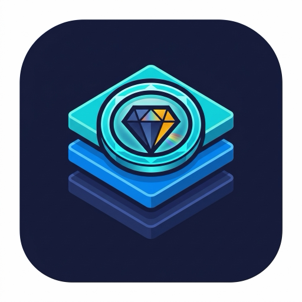

<div align="center">



# Skill Curator (Plugin Bundle · `v0.1.1`)

[Project README (English)](https://github.com/Khalilzhang0825/skill-curator/blob/main/README.md) | [中文完整文档](https://github.com/Khalilzhang0825/skill-curator/blob/main/README.zh-CN.md)

</div>

Cross-agent skill curation across three physical tiers: a capped **Global Core**, copy-mounted **Project Workspaces**, and an out-of-band **Skill Vault** indexed by `INDEX.md` with **Scene Tags** — with native Windows, macOS, and Linux support plus one-command multi-harness discovery & cleanup (`scan` / `adopt` / `remediate`).

## Requirements

- Python 3.9+ (standard library only; zero PyPI/Node runtime dependencies)
- `git` and `curl`
- Optional: Node.js / `npx` if installing standalone skill via `npx skills add`

## Quick Start

### macOS / Linux (`sh` / `bash` / `zsh`)

```bash
# Option A: Official npx skills CLI (e.g. Codex)
npx skills add Khalilzhang0825/skill-curator -a codex -g --copy -y

# Option B: Initialize Skill Vault + auto-discover existing harness dirs
./skills/skill-curator/scripts/curator.cmd init \
  --vault ~/.agents/skill-vault \
  --discover-global-dirs \
  --config ~/.config/skill-curator/config.json

# Scan existing local skills across harnesses before curating
./skills/skill-curator/scripts/curator.cmd scan --project-dir .
```

### Windows (PowerShell / `cmd.exe`)

```powershell
& .\skills\skill-curator\scripts\curator.cmd init `
  --vault "$HOME\.agents\skill-vault" `
  --discover-global-dirs `
  --config "$HOME\.config\skill-curator\config.json"

& .\skills\skill-curator\scripts\curator.cmd scan --project-dir .
& .\skills\skill-curator\scripts\curator.cmd remediate --dry-run --adopt <core-skill> --demote <extra-skill>
```

## Included Harness Adapters

- **Antigravity**: `plugin.json` (`assets/logo.png`) + `hooks.json` (`PreInvocation` via polyglot `hooks/run-hook.cmd`) + `rules/AGENTS.md` + `skills/skill-curator/SKILL.md`.
- **Claude Code**: `.claude-plugin/plugin.json` + `hooks/hooks.json` (`UserPromptSubmit` via polyglot `hooks/run-hook.cmd`) + `CLAUDE.md` + automatic `.claude/skills/<name>/` project mirroring.
- **Codex & Generic `AGENTS.md` Harnesses**: Works with `npx skills add ... -a codex -g --copy`; include `rules/AGENTS.md` in `~/.codex/AGENTS.md` or `~/.agents/AGENTS.md` for always-on curation rules.
